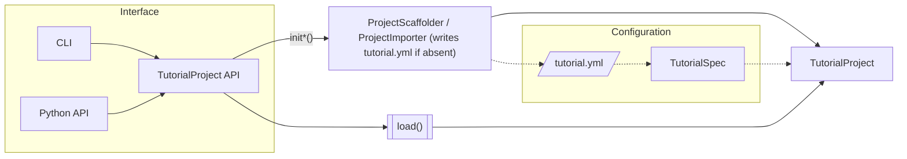
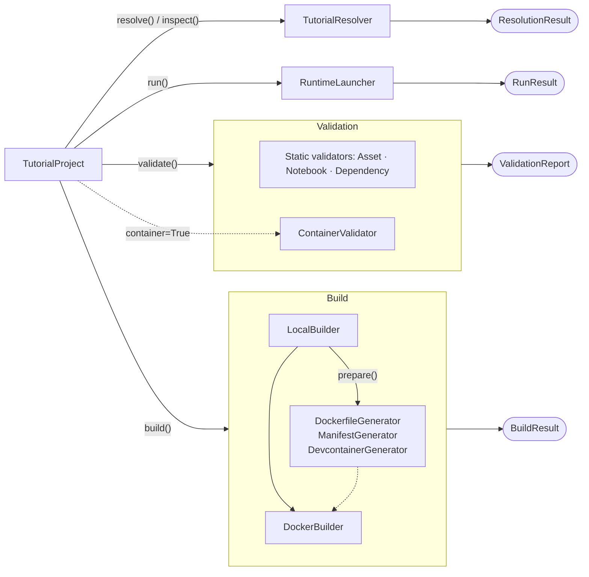
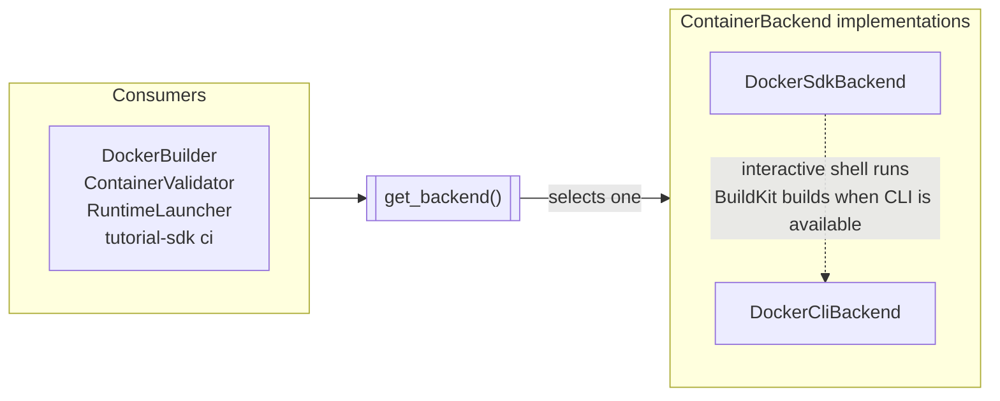
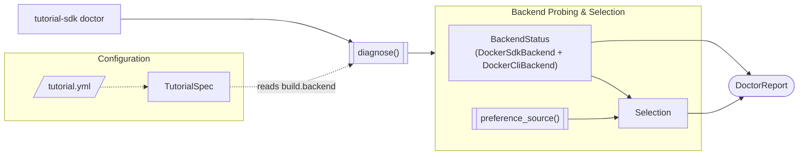

# Architecture & Design

`tutorial-sdk` separates **content assets**, **runtime environments**, and **build orchestration**. It treats tutorials as structured software packages rather than ad-hoc configurations of notebooks and environment setups.

---

## Modular Layout

The internal architecture divides duties across clear modules, ensuring high testability, predictable builds, and structured validation.

### Create or Load a Project



Create and import methods return a project instance and write `tutorial.yml` if it is absent. `load()` parses the existing file into a `TutorialSpec` and returns a project instance.

### Project Operations



`LocalBuilder.prepare()` generates the Dockerfile and, when enabled, the manifest and devcontainer files before handing the Dockerfile to `DockerBuilder`. Container validation is added only when `container=True` (dashed arrow).

### Backend Selection and Delegation



Every container operation obtains its implementation of the `ContainerBackend` protocol through `get_backend()`. `DockerSdkBackend` delegates interactive shell runs and BuildKit-required builds to `DockerCliBackend` when the Docker CLI is available (dashed arrow).

### Diagnostics



`diagnose()` reads `build.backend` from `tutorial.yml` when present (dashed arrow), mirrors backend selection with `preference_source()`, and probes both `DockerSdkBackend` and `DockerCliBackend` directly instead of selecting one through `get_backend()`.

### Pipeline Layers and Modules

| Pipeline Layer | Core Module | Architectural Duty |
| :--- | :--- | :--- |
| **Configuration** | `tutorial.yml` | Declarative package specification file defining content, build, and validation parameters. |
| | `TutorialSpec` | Strongly-typed configuration schema implemented with Pydantic v2 models; `TutorialSpec.load` parses and validates `tutorial.yml`, `write` serializes it back, and `display_title`, `effective_image`, and `resolve_image()` supply spec-derived defaults. |
| **Scaffold & Import** | `ProjectScaffolder` | Creates new tutorial projects from built-in templates (`minimal`, `workshop`, etc.), writing `tutorial.yml` if absent and returning a `TutorialProject` instance. |
| | `ProjectImporter` | Imports existing projects by scanning directories for notebooks, scripts, data, and docs; auto-extracts and cross-references dependencies from imports, install commands, requirement files, and `pyproject.toml` metadata; writes `tutorial.yml` if absent and returns a `TutorialProject` instance. |
| **Orchestration** | `TutorialProject` | Central API orchestrator: loading (`load`), project creation (`init`, `init_from*`), resolution, build delegation (via `LocalBuilder`), validation, and runtime execution. |
| | `TutorialResolver` | Resolves declared content paths against the project root into a `ResolutionResult`, recording missing paths (and `missing_relative_paths`) and delegating `image` to `TutorialSpec.effective_image` (used by `resolve()`, `inspect()`, and `AssetValidator`). |
| | `ResolutionResult` | Represents the outcome of resolving a tutorial specification against a project root (resolved content paths, missing paths, and effective image tag). |
| **Generation** | `DockerfileGenerator` | Compiles reproducible Dockerfiles from tutorial specifications. |
| | `ManifestGenerator` | Exports build manifest records (`tutorial-manifest.json`) for package traceability. |
| | `DevcontainerGenerator` | Synthesizes `.devcontainer/devcontainer.json` configuration structures for localized environments. |
| **Build** | `LocalBuilder` | Runs pre-build tasks in `prepare()` (always the Dockerfile; the manifest if `build.export_manifest`, the devcontainer if `build.export_devcontainer`) and delegates the image build to `DockerBuilder`, forwarding its `backend=` argument. |
| | `DockerBuilder` | Resolves the build settings (image tag, Dockerfile, layer caching, platform), resolves the backend forwarded by `LocalBuilder` through `get_backend()`, and builds the image through it. |
| | `BuildResult` | Represents the outcome of a container build, including the resulting image tag, Dockerfile path, image ID (native docker-py builds), and build status. |
| **Validation** | `AssetValidator` | Checks through `TutorialResolver` that every declared content path (notebooks, scripts, data, docs, exercises, solutions) exists. |
| | `NotebookValidator` | Parses notebook nodes, highlighting pre-existing execution exceptions or traceback errors. |
| | `DependencyValidator` | Checks whether declared pip packages are locally importable via `importlib`, generating warnings for unavailable modules. |
| | `ContainerValidator` | Performs live sandbox container boot checks and JupyterLab verification hooks through the selected container backend when `container=True`. |
| | `ValidationReport` | Formulates structured validation outputs, combining specific validation checks, warnings, and errors. |
| **Runtime Execution** | `RuntimeLauncher` | Launches container environments locally through the selected container backend, mapping host ports and optionally providing interactive shell access. |
| | `RunResult` | Represents the outcome of a foreground container execution (image tag, equivalent `docker run` command, and exit code). |
| **Container Backends** | `get_backend` | Returns a supplied `ContainerBackend` instance unchanged; otherwise selects by `--backend`, `TUTORIAL_SDK_BACKEND`, `build.backend`, then auto-detection. |
| | `preference_source` | Applies the backend selection precedence (`--backend`, `TUTORIAL_SDK_BACKEND`, `build.backend`, `auto`) without instantiating a backend and reports which rule decided. |
| | `ContainerBackend` | Protocol for every container operation (build, push, detached and foreground runs, exec, logs, copy, removal). Nothing above it depends on Docker types. |
| | `DockerCliBackend` | Implements the protocol with the `docker` binary and is the only module that executes `docker` subprocesses. `DockerSdkBackend` requires it for shell runs and uses it for BuildKit-only builds when the CLI is available. |
| | `DockerSdkBackend` | Implements the protocol with docker-py and the Docker Engine API (optional `tutorial-sdk[docker]` extra). |
| **Diagnostics** | `diagnose` | Read-only environment check behind `tutorial-sdk doctor` (changes nothing: no container is started and nothing is built or removed). It probes both backends directly and mirrors `get_backend`'s selection through `preference_source`, reading `build.backend` from `tutorial.yml` when present. |
| | `DoctorReport` | The resulting report: usable backends, the selected backend and deciding rule, the Docker client, daemon, and endpoint each backend uses, whether the daemon serves the classic builder that docker-py builds with, and containers carrying tutorial-sdk's managed-container label. |


### 1. Configuration Layer (`spec.py`, `config.py`)
- **`spec.py`**: Defines structured, strongly-typed schemas using **Pydantic v2** models (`TutorialSpec` and its nested sub-specifications), along with spec-derived helpers (`display_title`, `effective_image`, `resolve_image()`, and `to_manifest_dict()`).
- **`config.py`**: Defines `DEFAULT_CONFIG` (`tutorial.yml`) and `load_config`, a thin wrapper over `TutorialSpec.load`, which parses the YAML, validates it against the models, and raises `ConfigError` on failure.

### 2. Scaffold & Import Layer (`scaffold/`)
- **`templates.py`**: Defines `ProjectScaffolder`, which creates new tutorial projects from built-in templates (`minimal`, `notebook-tutorial`, `workshop`, `lab-exercise`, `demo`). Each template produces a ready-to-use directory layout with stub notebooks and a populated `tutorial.yml`.
- **`importer.py`**: Defines `ProjectImporter`, which scans an existing directory (local, remote Git URL, or GitHub `ORG/REPO`) to auto-detect notebooks, scripts, data files, and documentation. Python version is inferred from `.python-version` or `pyproject.toml`. Remote clones are persisted next to the target directory by default for inspection; pass `remove_clone=True` to delete them after import. The result is a fully populated `tutorial.yml` and a copy of discovered files in the target directory.

#### Dependency Detection

The importer collects Python dependencies from multiple sources and **cross-references** them to resolve module-name vs PyPI-package mismatches:

- `import` / `from ... import` statements in notebook code cells (AST-parsed);
- `%pip install`, `!pip install`, `%conda install`, `!conda install`, `%uv pip install`, `!uv pip install` commands in cells;
- `requirements.txt` and `requirements/*.txt` files;
- `pyproject.toml` `[project].dependencies` and `[project].optional-dependencies` (`[project].name` is included as an installable dependency).

Authoritative names from `pyproject.toml`, install commands, and requirements files take precedence over AST-derived import names. For example, if a notebook has `import rhapsody` but the `pyproject.toml` declares `project.name = "rhapsody-py"`, only `rhapsody-py` appears in the final dependency list.

### 3. Orchestration Layer (`project.py`, `resolver.py`)
- **`project.py`**: Defines `TutorialProject`, the primary programmatic API and central orchestrator of the SDK. It coordinates resolution, static and optional container validation, build-artifact generation and image builds (via `LocalBuilder`), and runtime execution. Provides `load()` for an existing `tutorial.yml`, `init()` for a new project (the `minimal` template via `ProjectScaffolder`), and `init_from()`, `init_from_url()`, and `init_from_github()` for importing existing projects (via `ProjectImporter`). `build()`, `validate()`, and `run()` accept an optional `backend=` keyword (a backend name or a `ContainerBackend` instance).
- **`resolver.py`**: Defines `TutorialResolver` and `ResolutionResult`. It resolves declared content paths against the project root, records the missing ones (including `missing_relative_paths`), and exposes `image` by delegating to `TutorialSpec.effective_image` (`build.image` or `<name>:latest`). `TutorialProject.resolve()`, `TutorialProject.inspect()`, and `AssetValidator` use it; image-tag consumers (`DockerBuilder`, `RuntimeLauncher`, `ContainerValidator`, `TutorialSpec.to_manifest_dict()`, and `tutorial-sdk ci`) resolve tags directly via `TutorialSpec.resolve_image()`.

### 4. Generation Layer (`generator/`)
- **`dockerfile.py`**: Compiles deterministic Dockerfiles configured with customizable snippet injections, `apt` and `pip` dependencies, local package installs, optional conda dependency comments, content copy rules, and runtime JupyterLab, shell, or command entrypoints.
- **`devcontainer.py`**: Synthesizes custom VS Code `.devcontainer/devcontainer.json` environment settings for seamless local containerized development.
- **`manifest.py`**: Generates a standard reproducibility catalog (`tutorial-manifest.json`) capturing environment specs, content declarations, and image tags for distribution and tracking.

### 5. Build Layer (`builder/`)
- **`docker.py`**: Defines `BuildResult` and the `DockerBuilder` adapter, which resolves the image tag, Dockerfile, layer-cache, and platform settings and builds the image through the selected container backend. Backend failures are reported as `BuildError`.
- **`local.py`**: Defines `LocalBuilder`. Its `prepare()` always writes the Dockerfile (`build.dockerfile`), writes `tutorial-manifest.json` when `build.export_manifest` is set (the default), and writes `.devcontainer/devcontainer.json` when `build.export_devcontainer` is set (off by default). `build()` accepts the `backend=` argument (a backend name or a `ContainerBackend` instance), runs `prepare()`, and then hands off to `DockerBuilder`, forwarding the backend; `DockerBuilder` is only ever called from `LocalBuilder`.

### 6. Validation Layer (`validator/`)
- **`assets.py` / `notebooks.py` / `dependencies.py`**: Run static inspections on local file references, scan Jupyter Notebook nodes for pre-existing run execution tracebacks or exceptions, and evaluate target python dependency sets against imports.
- **`container.py`**: Powers live, containerized validation checks by starting built images in the background through the selected container backend and executing verification suites inside (e.g., verifying that JupyterLab launches successfully). See [The Container Validation Model](#the-container-validation-model).
- **`report.py`**: Formulates structured validation outputs, combining specific `ValidationCheck` instances into a unified `ValidationReport`.

### 7. Runtime Execution Layer (`runtime/`)
- **`launcher.py`**: Implements `RuntimeLauncher`, which runs the tutorial image in the foreground through the selected container backend, mapping host ports and starting either the image's entrypoint (JupyterLab by default) or an interactive shell. See [Foreground Runs and Stop Policy](#foreground-runs-and-stop-policy).

### 8. Container Backend Layer (`backend/`)
- **`__init__.py`**: `get_backend()`, the single entry point through which `DockerBuilder`, `ContainerValidator`, `RuntimeLauncher`, and the `ci` command obtain a backend; `preference_source()`, which applies the same precedence without loading a backend and reports which rule decided; `BACKEND_CHOICES`. Importing the package never imports docker-py.
- **`base.py`**: The `ContainerBackend` protocol, the result types exchanged across it (`ImageBuildResult`, `ImagePushResult`, `ContainerHandle`, `ExecResult`, `RunExit`), the diagnostic types (`BackendInfo`, `ManagedContainer`), and the helpers shared by both backends so their behavior cannot drift (`observe_running`, `trap_signals`, `STOP_GRACE`, `STOP_HINT`, `MANAGED_LABEL`).
- **`errors.py`**: Backend failures (`ImageBuildFailed`, `ImagePushFailed`, `ContainerStartFailed`, `CopyFailed`). They derive from `tutorial_sdk.errors.BackendError`, like `BackendUnavailableError`.
- **`docker_cli.py`**: `DockerCliBackend`, built on the `docker` binary. It is the only module in the SDK that runs `docker` (enforced by a test).
- **`docker_sdk.py`**: `DockerSdkBackend`, built on docker-py. docker-py is imported lazily, and every docker-py, `requests`, and `urllib3` error is translated into the backend error types, so no docker-py type escapes this module.

### 9. Diagnostics (`doctor.py`)
- **`doctor.py`**: `diagnose()` builds the `DoctorReport` printed by [`tutorial-sdk doctor`](cli.md#doctor). It changes nothing: no container is started and nothing is built or removed (the `docker-sdk` classic-builder probe sends a `FROM scratch` build request, which the builder rejects).

---

## Container Backends

Every container operation — building and pushing images, container validation, and `tutorial-sdk run` — goes through a **container backend**. Two backends implement the same `ContainerBackend` protocol, and a contract test suite runs against both so they stay equivalent:

| Backend | Talks to Docker through | Needs |
| :--- | :--- | :--- |
| `docker-cli` | the `docker` command-line client | the `docker` binary on `PATH` |
| `docker-sdk` | docker-py and the Docker Engine API | `pip install 'tutorial-sdk[docker]'` and a daemon that answers a ping |

Public APIs, validation check names, and the SDK's own message text are the same with either backend; text that comes from Docker (daemon errors, build output) is backend-specific.

### Backend Selection

The backend is chosen per command, by the first of these rules that names one:

1. the `--backend` option of `build`, `validate --container`, `run`, `ci`, and `doctor` (or the `backend=` argument in the Python API);
2. the `TUTORIAL_SDK_BACKEND` environment variable;
3. the `build.backend` field of `tutorial.yml`;
4. auto-detection (`auto`).

At every level `auto`, or no value, means "no preference" and defers to the next rule, so `--backend auto` does not override `TUTORIAL_SDK_BACKEND`. A value other than `auto`, `docker-cli`, or `docker-sdk` is a configuration error (an unknown `build.backend` is already rejected when `tutorial.yml` is loaded). Auto-detection uses `docker-sdk` when docker-py is installed and the daemon answers a ping, and otherwise `docker-cli` when the `docker` binary is on `PATH`; if neither works, the command fails with an error explaining both. There is no fallback from a backend chosen explicitly: `docker-sdk` pings the daemon when it is selected, so the command fails at once if the daemon does not answer, while `docker-cli` only needs the `docker` binary and reports an unreachable daemon when it first runs a Docker command.

In the Python API, `backend=` also accepts a ready `ContainerBackend` instance, which is used as is (the environment variable and `build.backend` are not consulted). This is how tests and embedding applications run the SDK without Docker.

`tutorial-sdk doctor` shows which backend a command would select and which rule decided; see [`doctor`](cli.md#doctor).

### Native vs. Delegated `docker-sdk` Operations

`DockerSdkBackend` builds and pushes images, runs container validation, and runs `tutorial-sdk run` through the Docker Engine API, without the `docker` binary. Two cases go through the Docker CLI instead:

- **`run --shell`** always needs the Docker CLI, because docker-py cannot attach a terminal. Without the `docker` binary, the command fails and says so (selecting `--backend docker-cli` would not help, since it needs the same binary).
- **Dockerfiles that need BuildKit.** The Engine API build endpoint that docker-py uses runs Docker's *classic* builder, which does not understand BuildKit features. Dockerfiles that use them are built through the Docker CLI when the `docker` binary is installed; otherwise the build is attempted natively, where the classic builder rejects it (for example `the --mount option requires BuildKit`) or, for directives it ignores such as `# syntax=`, builds it without BuildKit's semantics. The features detected are:
    - parser directives (`# syntax=...`, `# check=...`);
    - BuildKit-only `RUN`/`COPY`/`ADD` flags: `--mount`, `--network`, `--security`, `--secret`, `--ssh`, `--link`, `--chmod`, `--parents`, `--exclude`, `--checksum`, `--keep-git-dir`, `--unpack`;
    - heredocs (`RUN <<EOF`);
    - the automatic platform arguments (`$BUILDPLATFORM`, `$TARGETPLATFORM`, `$TARGETARCH`, etc.).

    Dockerfiles generated by `DockerfileGenerator` never need BuildKit, so routing is only triggered by `build.custom_sections` snippets or hand-written Dockerfiles. The detection is conservative: a false positive only means the build runs through the Docker CLI.

With docker-py, the daemon is found through `DOCKER_HOST`; when it is unset and the default socket does not answer, the current Docker context's endpoint is used (Docker Desktop, Colima, OrbStack). See [Troubleshooting](troubleshooting.md#docker-py-cannot-find-the-daemon).

### Builds

- **Output.** Builds are silent by default, as they always were. `--build-output` (or `log_callback=` in the Python API) prints each line of build output as it is produced. When a build fails without `--build-output`, the error message (`Build error:...`) contains the build output; with it, the output has already been shown and the message is short (`Docker build failed` with the CLI backend, the builder's error with the docker-py backend).
- **Log format differs by backend.** The docker-py backend uses the classic builder (`Step 1/4 : FROM ...`, ` ---> 3f2a...`), the Docker CLI typically uses BuildKit, the default builder of current Docker releases (`#1 [internal] load build definition...`). Neither is parsed by the SDK, so do not depend on either format.
- **`BuildResult.digest`** is the built image ID (`sha256:...`) for native docker-py builds, and `None` with the CLI backend (including builds the docker-py backend routes through the Docker CLI).
- Classic and BuildKit builds of the same Dockerfile produce different image IDs, and therefore different pushed digests. Nothing in the SDK compares them across backends.

### Pushes

`tutorial-sdk ci --push` pushes through the same backend that built the image. Registry credentials come from the Docker configuration and credential helpers (`docker login`), as for `docker push`, with either backend. A tag without a version pushes `:latest`. The reported digest is the part after `@` of the image's first repository digest; both backends read the same daemon field, so they agree.

### Foreground Runs and Stop Policy

`tutorial-sdk run` runs the container in the foreground: its output goes to the terminal, and the container is removed when it exits, including after an interrupt. Both backends apply the same stop policy:

1. The first Ctrl-C prints `Stopping container (interrupt again to force)...` and asks the container to stop.
2. A container that is still running 10 seconds later, or when Ctrl-C is pressed again, is killed and removed.

How the end of the run is reported differs:

| | `docker-cli` | `docker-sdk` |
| :--- | :--- | :--- |
| **First Ctrl-C** | The terminal delivers it to the `docker` client, which forwards it to the container. | Forwarded to the container by the SDK; `SIGTERM` sent to `tutorial-sdk` is forwarded too. |
| **Forced stop** | `docker rm -f <container>` | The container is killed, then removed. |
| **Result** | The run ends with a `KeyboardInterrupt`. | The command exits with the container's exit code (no traceback). |
| **Daemon error before the container starts** | `docker run`'s message and exit code (`125`). | `Error response from daemon:...` and exit code `125`. |

`run --shell` always goes through the Docker CLI, so with `docker-sdk` it behaves as in the `docker-cli` column.

The CLI backend identifies the container through a container-ID file (`docker run --cidfile`), so it can remove a container that ignores Ctrl-C. If removal fails it prints `Warning: could not remove container <id>:...` (or ``Warning: could not identify the container started by `docker run` ``) and the interrupt still propagates; `tutorial-sdk doctor` then lists the container. `RunResult.command` always reports the plain equivalent command, `docker run --rm [-p HOST:CONTAINER] [-it --entrypoint /bin/sh] IMAGE`, whichever backend ran it.

With `--shell`, the terminal is in raw mode, so Ctrl-C is a keystroke for the container's shell, not an interrupt for `tutorial-sdk`; leave the shell with `exit`.

With the docker-py backend, the container's output is read from its logs, so it needs a logging driver that can be read back (the default `json-file` and `local` drivers can; `none` cannot, in which case one warning is printed and the exit code is still returned).

### Managed-Container Label

Containers started by `tutorial-sdk run` carry the label `org.bnl-peso-hub.tutorial-sdk.managed=true`, on both backends. The label marks ownership: it lets `tutorial-sdk doctor` (and you) find containers started by tutorial-sdk without relying on their names, for example one left running because the `tutorial-sdk` process was killed with SIGKILL:

```bash
docker ps --all --filter label=org.bnl-peso-hub.tutorial-sdk.managed=true
```

A labelled container is not necessarily orphaned — a `tutorial-sdk run` may still be using it. Containers started by container validation are not labelled; they are named `tutorial-sdk-val-<name>` and the next validation of the same project removes a leftover one.

---

## The Container Validation Model

A major architectural pillar of `tutorial-sdk` is the live **Container Validation** system. Unlike standard static linters, the validation pipeline operates on two distinct layers:

### Local Static Validation
1. **Asset Checks**: Verifies that every single declared file and dataset is located at the specified path in the project workspace.
2. **Import Integrity**: Performs localized dry-run module checks for import-like pip packages, generating warnings for packages that are missing from the current interpreter.
3. **Stored Notebook Checks**: Parses notebook JSON fields to check for existing cell execution exceptions or stack traces.

### Live Container Validation
When `--container` is triggered, or during CI in `test` / `all` modes after a build, the selected container backend:

1. Starts the built image in the background as `tutorial-sdk-val-<name>`, removing a stale container of that name first. A container that cannot be started fails the `container.start` check.
2. Watches the container for a 2-second observation window. If it stops during the window, `container.start` fails immediately and the report includes the container's logs (stderr, or stdout when stderr is empty). There is no fixed sleep: a crashing container is reported as soon as it exits, and a healthy one passes when the window ends.
3. Runs `jupyter lab --version` inside the container. The `container.jupyterlab` check passes with the reported version, or fails with the command's error output.
4. Removes the container in every case.

The check names (`container.start`, `container.jupyterlab`) and messages are the same with both backends. If no backend is available, `validate --container` fails with `Docker is not installed or not on PATH.` — `tutorial-sdk doctor` shows the underlying reason.

---

## Extension & Escape Hatches

The SDK provides controlled override blocks for custom steps, allowing authors to inject customized commands into generated Dockerfiles without having to modify the generated files by hand:

```yaml
build:
  custom_sections:
    before_dependencies: docker/before-deps.Dockerfile
    after_dependencies: docker/after-deps.Dockerfile
    before_entrypoint: docker/before-entry.Dockerfile
```
These snippets are safely read by `DockerfileGenerator` and seamlessly compiled into the final Dockerfile generation pipeline. With the docker-py backend, a snippet that uses BuildKit features routes the build through the Docker CLI (see [Native vs. Delegated `docker-sdk` Operations](#native-vs-delegated-docker-sdk-operations)).
