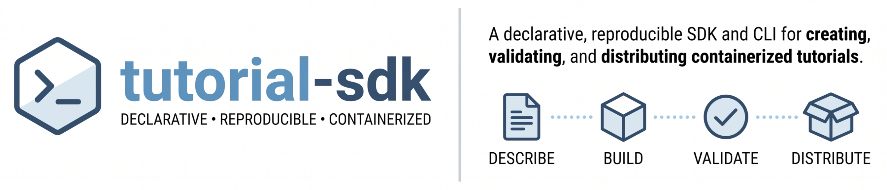

# 

A **declarative, reproducible tutorial packaging system** and command-line tool that bridges the gap between technical content and stable containerized runtimes.

`tutorial-sdk` moves technical content creators from hand-crafted Dockerfiles, floating dependencies, and loose notebooks to structured, reproducible tutorial package management. A single, Pydantic-validated `tutorial.yml` declares the full tutorial specification — metadata, contents, package environments, and validation rules — while the SDK synthesizes deterministic Dockerfiles, runs notebook-aware local and container validation, integrates with GitHub Actions via `tutorial-sdk ci`, and provides scaffolding templates for workshops, course modules, or custom lab exercises.

---

## Installation

Install `tutorial-sdk` from PyPI:

```bash
pip install tutorial-sdk
```

To use docker-py for container operations (the `docker-sdk` backend), install
the `docker` extra:

```bash
pip install 'tutorial-sdk[docker]'
```

The base install needs only `pydantic` and `PyYAML`; configuration,
scaffolding, Dockerfile generation, and static validation work without Docker.

### Choosing a Container Backend

`build`, `validate --container`, `run`, and `ci` talk to Docker through a
container backend: the Docker CLI (`docker-cli`) or docker-py (`docker-sdk`).
By default (`auto`), docker-py is used when it is installed and the Docker
daemon answers, and the Docker CLI otherwise. To choose one, pass
`--backend`, set `TUTORIAL_SDK_BACKEND`, or set `build.backend` in
`tutorial.yml` (see [Choosing a Container Backend](cli.md#choosing-a-container-backend)).

Check what is available, and what a command would use, with:

```bash
tutorial-sdk doctor
```

With docker-py, Docker Desktop, Colima, and OrbStack are found through the
current Docker context when `DOCKER_HOST` is unset (see
[Troubleshooting](troubleshooting.md#docker-py-cannot-find-the-daemon)).

---

## Quickstart

Get up and running in a few simple steps.

### 1. Initialize a Project
Create a new tutorial project from the built-in minimal template:
```bash
tutorial-sdk init my-new-tutorial
cd my-new-tutorial
```

### 2. Verify Specs and Contents
Inspect the resolved configuration structure and assets:
```bash
tutorial-sdk inspect
```

### 3. Validate, Build, and Run
Validate all declared notebook files, dependencies, and paths locally, then compile the container environment:
```bash
# Validate local specs, files, and imports
tutorial-sdk validate

# Generate the Dockerfile and build the image
tutorial-sdk build

# Spin up the JupyterLab server inside the container locally
tutorial-sdk run
```

---

## Project Structure

A typical `tutorial-sdk` managed repository looks like this:

```text
my-tutorial/
  ├── tutorial.yml        # Source of truth specification
  ├── Dockerfile          # Deterministic generated artifact
  ├── README.md           # Instructional document
  ├── notebooks/
  │   └── 01-intro.ipynb  # Interactive tutorials
  ├── data/
  │   └── dataset.csv     # Accompanying datasets
  └── scripts/
      └── helpers.py      # Python utility modules
```

> **Note:** Generated artifacts include: (a) `tutorial-manifest.json` — full details of the resulting tutorial package (dependencies, content, entrypoint, etc.); (b) `tutorial-validation.json` — automated validation check report (checks, warnings, and errors).
